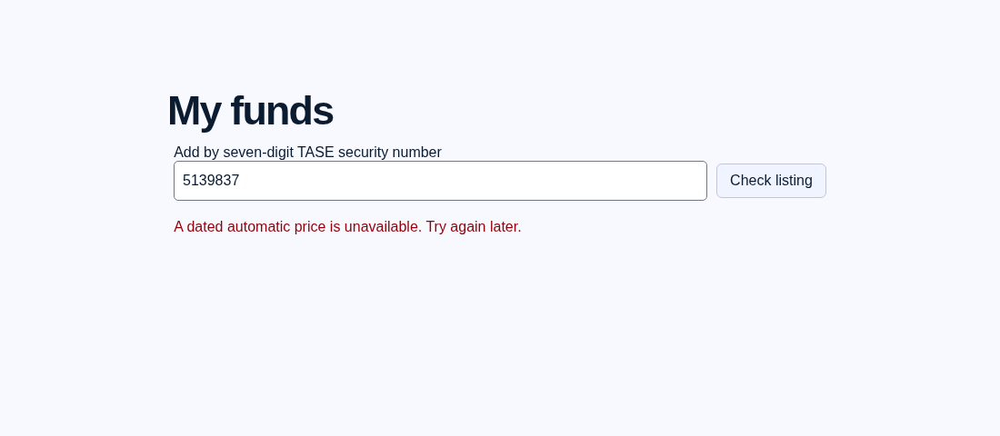
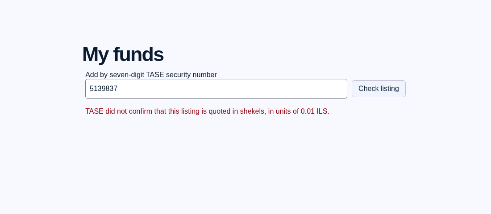

# My Funds verification evidence — 2026-11-11

## Official foreign ETF evidence

Recorded fixtures in `tests/fixtures/foreign_etfs/` were fetched from the official
TASE `company/securitydata?securityId={id}&lang=1` and
`export/securityhistoryeod` endpoints through the pinned tasekit client.
CSV fixtures retain the original preamble, column headers and latest two rows.
No example identifiers appear in the admission rules.

| Security | ShareType | SecuritySubType | ISIN |
| --- | --- | --- | --- |
| 1209220 | 4401 | Trade foreign fund Equity | IE000716YHJ7 |
| 1159169 | 4401 | Trade foreign fund Equity | IE00BKM4GZ66 |
| 1159151 | 4501 | Traded foreign fund Bonds | IE00BYXYYP94 |
| 1159250 | 4401 | Trade foreign fund Equity | IE00B5BMR087 |

All four return `Type: Foreign ETF`, `IsForeignETF: true`, `isTrading: true`,
`SuspendStatus: null`, a matching zero-padded `Id`, and a nonempty `LongName`.
The admission rule requires those fields and the matching ShareType/subtype pair.
Missing suspension status is rejected, as are wrong-class, share, bond, warrant,
index, suspended and nontrading payloads.

**Currency and units come from the official CSV's exact
`Closing Price (0.01 ILS)` column, not `Currencies: [US Dollar]` in metadata.**
The latter describes the foreign fund's base currency. Unknown units, absent
prices, or unusable dates fail closed. The existing published-EOD downloader,
latest actual data date, and agorot/100 conversion are reused.

An initial bare HTTP metadata request returned an Incapsula challenge. Requests
through tasekit with its normal headers succeeded; no TLS or document check was
bypassed.

## Clean API dependency diagnosis

Created a fresh virtual environment and installed only the original
`api/requirements.txt`. `importlib.util.find_spec('pypdf')` returned `None`.
Calling `verify_fund('TASE', '5139837')` returned the old `price` error.
After installing the root pin `pypdf==7.0.0`, the same call passed, fetched and
parsed official PDF report 1732868, and returned a dated redemption quote.

The parser import remains outside its PDF-validation catch: a missing dependency
propagates to the outer unexpected-error handler and now uses the separate
`verification` message. Invalid/unproven documents still use `document`;
expected absent/invalid dated prices still use `price`.

## Live-provider checks with patched local verifier

These call the real providers from this cloud environment, without fixture
substitution. They are not deployed HTTP results.

| Security | Local result | ILS price | as_of |
| --- | --- | --- | --- |
| 1209220 | PASS | 29.43 | 2026-11-10 |
| 1159169 | PASS | 159.3 | 2026-11-10 |
| 1159151 | PASS | 20.3251 | 2026-11-10 |
| 1159250 | PASS | 2585.0 | 2026-11-10 |
| 5139837 | PASS; unit report 1732868 | 1.0832 | 2026-11-09 |
| 5135694 | REJECTED: document | — | — |
| 1150366 | PASS (Israeli ETF control) | 33.84 | 2026-11-10 |

### Unresolved: 5135694 official document proof

MAYA reports redemptionPrice 121.13 and ratesAsOf 2026-11-10, annual report
1767479, no financial report ID, and prospectus report 1454757. Both official
PDFs fetched successfully from `mayafiles.tase.co.il` with PDF content types and
parsed with `PdfReader(..., strict=True)` (seven pages each). Both return false
from the existing report verifier. This is not a report-host access failure in
this environment.

The annual report identifies security 5135694 and extracts the nominal statement
`המטבע שבו נקובות יחידות הקרן 1 ₪.ערך נקוב`, which does not match the existing
explicit templates. Its redemption table extracts `מחיר הפדיון ליום המסחר האחרון
של התקופה` without the required explicit percentage-of-nominal statement.
The prospectus also does not satisfy the existing unit and percentage proof.
No new loose pattern or automatic document pass was added. Further official
proof is needed before this fund can safely pass; installing pypdf alone does
not resolve this second failure.

## Production HTTP checks and deployment limit

POSTs to `https://signalboard-dun.vercel.app/api/my-funds/check`, with JSON
`{"market":"TASE","identifier":"<number>"}`, returned:

| Security | HTTP | Response |
| --- | --- | --- |
| 1209220 | 401 | `{"detail":"Sign in to continue."}` |
| 1159169 | 401 | `{"detail":"Sign in to continue."}` |
| 1159151 | 401 | `{"detail":"Sign in to continue."}` |
| 1159250 | 401 | `{"detail":"Sign in to continue."}` |
| 5139837 | 401 | `{"detail":"Sign in to continue."}` |
| 5135694 | 401 | `{"detail":"Sign in to continue."}` |
| 1150366 | 401 | `{"detail":"Sign in to continue."}` |

No authenticated production session or deployment credentials were configured
in this environment. This branch has not been deployed or merged. Therefore
post-deployment verification and the serverless report-host access check remain
outstanding; the local provider results do not establish serverless behavior.
No funds were added. Signing-key configuration, storage/signatures, SQL and
portfolio/trading behavior were not changed.

## Targeted validation and screenshots

`PYTHONPATH=src pytest -q tests/test_fund_verification.py tests/test_tase_data.py`
passes: **54 tests**. This includes recorded positive foreign listings, generic
same-class admission under a different identifier, wrong-class/inactive cases,
explicit currency/units enforcement, dated prices, missing/present pypdf, and
truthful unexpected-error reporting. `git diff --check` passes.

The screenshots render the real unchanged `FundRegistration` React component
and repository CSS in a local harness. Only its API transport is mocked to
return the specified 422 text. They demonstrate error presentation, not a
production login or a deployed provider failure.

Before (unexpected failure incorrectly reported as price unavailable):

After (separate unexpected-verification message):

Foreign listing with unproven local quote currency/units:

